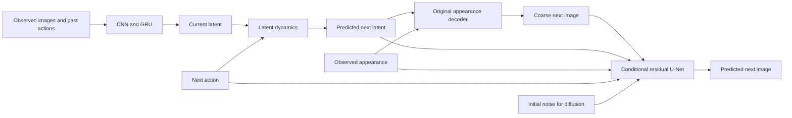

# Action-Conditioned Visual Prediction

### Deterministic and Diffusion Residual Decoders on BAIR

[](https://github.com/Elaybarnoam/action-conditioned-visual-world-model/actions/workflows/ci.yml)
[](LICENSE)
[](https://github.com/Elaybarnoam/action-conditioned-visual-world-model/releases/tag/v1.0.0)

**Frozen empirical research software:** matched controls, explicit mathematics,
saved predictions, per-window scores, model artifacts and negative results.


BAIR imagery: Ebert et al. (2017), CC BY 4.0. Predictions, captions and layout
are derived outputs. Every fixed diffusion sample is shown.

## Abstract

We study how image-generation heads affect perceptual fidelity and target
accuracy in action-conditioned visual prediction. A CNN/GRU world model
summarizes eight observed frames and past actions, predicts a next latent
state from a supplied action, and decodes a coarse next image. Holding this
trained backbone fixed, we compare identically initialized conditional
residual U-Nets: a deterministic head trained with RGB squared error and a
v-parameterized diffusion head sampled with DDIM. Both train for 6,000 updates
on a 10,000-recording BAIR subset with matched architecture, data order and
fresh optimizers. On 1,122 validation windows, the deterministic head reduces
MSE by 33.96% and LPIPS by 53.54%. Diffusion reduces LPIPS by 61.96% and yields
sharper inspected samples, but increases MSE by 24.71% and changed-region error
by 40.98%. The study identifies a useful deterministic rendering improvement
and a perceptual-fidelity/target-accuracy tradeoff at this budget. Evidence is
limited to one training seed, one-step prediction and validation reuse for
checkpoint selection.

## Research question and contributions

**How do deterministic and diffusion residual heads affect detail and accuracy
when the temporal backbone and conditioning are held fixed?**

- A paired architecture/initialization/data-order controlled comparison.
- Precise separation of physical state, observed history, latent dynamics,
  coarse rendering and stochastic residual generation.
- Individual-sample scoring, action controls, recording-level descriptive
  bootstrap intervals, preserved failures and historical ablations.
- A dependency-free demo and checksum-pinned weights with reproduction tools.

This is empirical research software. No new diffusion algorithm, leaderboard
record, peer-review acceptance or general causal-physics capability is claimed.

## Main findings

Lower is better except SSIM. Diffusion scores include all three samples per
window; no sample is chosen using the recorded answer.

| Model | MSE ↓ | Changed MSE ↓ | Boundary MAE ↓ | LPIPS ↓ | SSIM ↑ |
|---|---:|---:|---:|---:|---:|
| Original appearance model | 0.0081583 | 0.0260891 | 0.041479 | 0.122070 | 0.829122 |
| Deterministic residual U-Net | **0.0053881** | **0.0189077** | **0.028624** | 0.056710 | **0.904001** |
| Diffusion residual U-Net | 0.0101739 | 0.0367802 | 0.036284 | **0.046433** | 0.848224 |

1. **The deterministic head offers the strongest tested accuracy/appearance
   compromise.** It improves all five metrics and passes pilot criteria.
2. **Diffusion improves detail and perceptual distance with an accuracy cost.**
   Its sampled placements/details vary; it fails frozen pixel/change guards.
3. **A stronger rendering head helps this frozen backbone.** The comparison
   does not isolate a single feature path or architectural bottleneck.
4. **Irreducible uncertainty is not established as the cause of blur.** Sample
   dispersion is uncalibrated; optimization/generalization issues remain.

The [experiment report](docs/experiments.md) includes uncertainty intervals,
negative findings, compute, claim-to-evidence mapping and all limitations.

## Architecture and mathematical overview



The original decoder remains present. Phase E freezes the 1,997,987-parameter
backbone and trains a 1,934,819-parameter head per branch. Let

$$
z_t=E_\phi(h_t),\qquad \hat z_{t+1}=T_\psi(z_t,a_t),\qquad
b_{t+1}=D_\omega(\hat z_{t+1},A_t).
$$

Both heads receive target-free context $c_t$: observed image/features and frame
difference, predicted latent, action and coarse prediction. Deterministic output:

$$
\hat o_{t+1}=\operatorname{clip}_{[0,1]}
\left(b_{t+1}+\tfrac12R_\theta(c_t)\right).
$$

Diffusion trains on clean residual $r_0=2(o_{t+1}-b_{t+1})$:

$$
r_n=\sqrt{\bar\alpha_n}r_0+\sqrt{1-\bar\alpha_n}\epsilon,\qquad
v_n=\sqrt{\bar\alpha_n}\epsilon-\sqrt{1-\bar\alpha_n}r_0,
$$

$$
\mathcal L_{\mathrm{diff}}=
\mathbb E[\operatorname{mean}(v_\theta(r_n,n,c_t)-v_n)^2].
$$

The target constructs training corruption/supervision only. Inference starts
from random noise conditioned on observations; each seed generates one sample.
Here v is a diffusion parameterization, not physical robot velocity.

The [full formulation](docs/formulation.md) defines all symbols, time indexing,
shapes, objectives, cosine schedule, DDIM steps, EMA and metrics. The
[architecture document](docs/architecture.md) provides layer shapes and pseudocode.

## Dataset and protocol

| Item | Frozen setting |
|---|---|
| Data | BAIR original v0, main camera, 64x64 RGB |
| Recording splits | 10,000 train / 51 validation / 256 official test |
| Inputs | 8 observations, 7 past actions, next 4-D action; no robot positions |
| Training | Seed 3; 6,000 updates/head; batch 16; Adam 0.0002; float32 |
| Selection | 51 fixed validation starts, EMA every 1,000 updates |
| Final comparison | 1,122 validation windows; 3,366 diffusion samples |
| Sampling | 100 cosine timesteps; 50 DDIM steps; seeds 1301/2603/3907 |

Complete recordings stay in one split. Training is expanded in archive order,
retaining the original holdout; this is not the full BAIR training corpus.
Final validation includes selection windows. Sampling seeds are not training
replications. Earlier phases used official test data; phase E reports validation
only. New-head multistep quality is untested.

## Quick start: saved results without PyTorch

```bash
git clone https://github.com/Elaybarnoam/action-conditioned-visual-world-model.git
cd action-conditioned-visual-world-model
python -m src.publication verify
python -m src.evaluation.publication --check
python -m src.publication demo --port 8768
```

Open **http://127.0.0.1:8768/**. Python 3.11+ is sufficient. The demo browses
the six exact saved comparisons, actions and observed histories. It performs
no inference or training and displays all three samples without averaging.

## Released models and reproduction

Install [uv](https://docs.astral.sh/uv/getting-started/installation/), then:

```bash
uv sync --locked
python -m src.publication fetch --bundle inference
uv run --locked python -m src.release_eval --smoke --device cuda:0
```

Use --device cpu for CPU fixture checks. The recorded environment is Python
3.11/PyTorch 2.13/CUDA 13. The inference bundle contains backbone, EMA heads,
verification fixtures and dataset manifest. Weights and optimizer-state bundles
are [release assets](https://github.com/Elaybarnoam/action-conditioned-visual-world-model/releases/tag/v1.0.0),
with SHA-256 checksums; binary checkpoints are not committed to Git.

```bash
# Full data reconstruction and validation scoring:
uv run --locked python -m src.release_eval --prepare-data --device cpu
uv run --locked python -m src.release_eval --evaluate --device cuda:0
# Explicit new training reproduction:
uv run --locked python -m src.release_eval --retrain --mode deterministic --device cuda:0
uv run --locked python -m src.release_eval --retrain --mode diffusion --device cuda:0
```

Full preparation needs substantial download/storage. Ordinary tests and the
demo need neither. [Reproducibility instructions](docs/reproducibility.md)
cover checkpoint continuation, environment constraints, tolerances and costs.
Model executions create dedicated ignored evaluation/runs/run-NNN records.

## Evidence and documentation

- [Main table](results/main-results.csv), [all score rows](results/per-window/),
  [bootstrap](results/recording-bootstrap.json), [curves](results/figures/learning-curves.png).
- [Frozen protocol](results/protocols/phase-e.json), [release hashes](results/release-manifest.json),
  [paired-condition audit](results/paired-initial-audit.json), [experiment index](results/experiment-index.json).
- [Model card](docs/model-card.md), [limitations](docs/limitations.md),
  [evidence checklist](docs/evidence-audit.md), [related work](docs/related-work.md),
  [contributing](CONTRIBUTING.md).

Historical training predates Git and retains source fingerprints. The later
source import and portable exports are identified explicitly. Local plans,
caches, raw data, environments and full working runs remain ignored; curated
publication evidence is under results/.

## Intended use and citation

This one-seed, one-step study supports research and education. Sharpness, low
LPIPS and action sensitivity do not establish calibrated uncertainty, causal
dynamics or reliable robot control. See [limitations](docs/limitations.md).

Cite the versioned software through [CITATION.cff](CITATION.cff). Scientific
references are in [references.bib](docs/references.bib). Code and released model
parameters: [MIT](LICENSE), Elay Barnoam, 2026. BAIR-derived imagery retains
CC BY 4.0; external evaluation metrics retain upstream terms. See
[third-party notices](THIRD_PARTY_NOTICES.md). Codex assisted development under
the maintainer's direction. No DOI, degree or academic affiliation is asserted.
