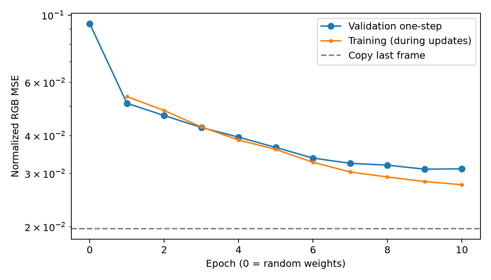
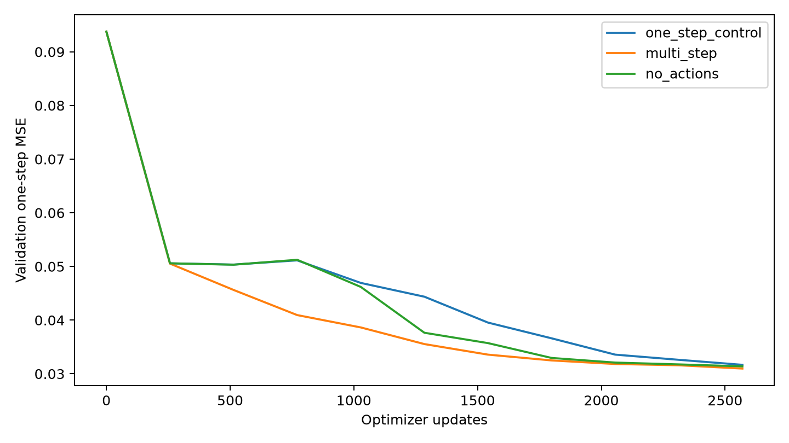
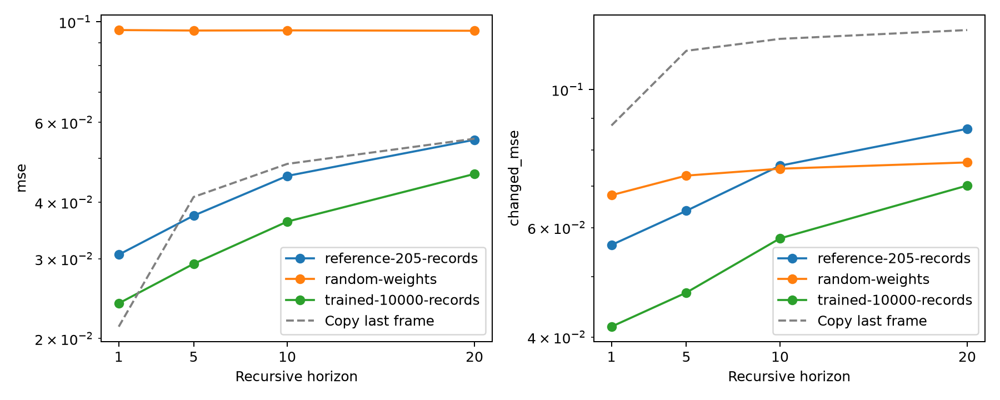
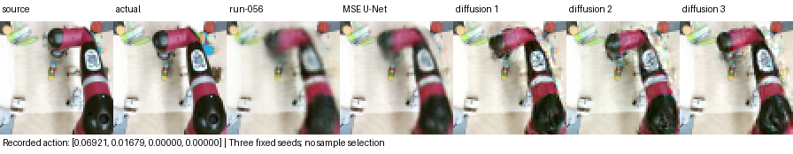
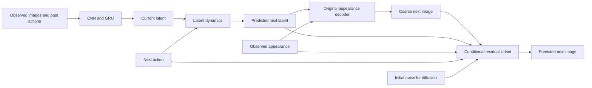

# Learning Action-Conditioned Visual World Models

### From camera observations and recurrent dynamics to multistep prediction and image generation

[](https://github.com/Elaybarnoam/action-conditioned-visual-world-model/actions/workflows/ci.yml)
[](LICENSE)
[](https://github.com/Elaybarnoam/action-conditioned-visual-world-model/releases/tag/v1.1.0)

**Frozen empirical research software:** matched controls, explicit mathematics,
the complete implementation history, saved predictions, per-window scores,
every saved checkpoint, model artifacts and negative results.

**New experiment:** [higher-resolution DROID pilot](docs/droid-experiment.md).
Its data protocol and run records are separate from the frozen BAIR study below;
the first baseline is trained and evaluated, with mixed accuracy/detail results.

## Abstract

This project develops and investigates a visual world model that predicts
future camera observations from an observed image/action history and supplied
future actions. Starting from random weights, we implement a CNN encoder,
GRU memory, action-conditioned latent transition and image decoder, then
study fitting, temporal generalization, action dependence, data scaling,
appearance preservation, motion transport and probabilistic image generation.
The BAIR training subset grows from 205 to 10,000 recordings while its original
validation and official-test recording identities remain fixed. Initial
one-step training improves over random weights but loses to copying the last
frame; three-step supervision and expanded training improve recursive errors.
Later experiments investigate persistent blur through reconstruction controls,
loss/capacity changes, observed appearance, copy/warp/generate rendering,
spatial memory, flow diagnostics and curriculum training. The final matched
residual-head comparison finds a deterministic accuracy improvement and a
diffusion perceptual-fidelity/target-accuracy tradeoff. The release preserves
the entire experimental progression, including failures, evaluations,
numerical predictions and all saved checkpoints. Findings remain conditional
on the reported budgets, limited training replications and reused holdouts.

## Research question and contributions

**How can a compact learned model turn observed images and actions into useful
future predictions, and which interventions improve its dynamics and rendering?**

- An implementation from data acquisition through CNN/GRU representation,
  latent dynamics, decoding, joint training and recursive evaluation.
- Controlled studies of temporal supervision, action use, data scaling,
  appearance access, transport, spatial memory, losses and curriculum.
- A final paired deterministic/diffusion residual-head comparison.
- Precise separation of physical state, observed history, latent dynamics,
  coarse rendering and stochastic residual generation.
- Individual-sample scoring, action controls, recording-level descriptive
  bootstrap intervals, preserved failures and historical ablations.
- A dependency-free demo, complete run/checkpoint catalog and checksum-pinned
  historical artifacts with reproduction and inspection tools.

This is empirical research software. No new diffusion algorithm, leaderboard
record, peer-review acceptance or general causal-physics capability is claimed.

## Project milestones and measured progression

| Milestone | Implementation / research question | Saved evidence and conclusion |
|---|---|---|
| 0–3: foundations | Python setup, verified BAIR records, CNN features, GRU memory | run-001–004: inspectable data and random component snapshots |
| 4–9: first complete model | Joint encoder/memory/dynamics/decoder training and frozen evaluation | run-005–009: saturation diagnosed; corrected run-007 improves over random weights but trails copying |
| Temporal/action diagnosis | Tiny fitting, refreshed history, one- versus three-step supervision, action interventions and trained no-action control | run-010–021: tiny fit succeeds; three-step training improves recursive error; failures and recovery preserved |
| Data expansion | Exact 10,000-recording training set, immutable holdouts, packed loader | run-022–032: expanded model lowers test h20 MSE from 0.054927 to 0.046178; one-step still trails copy |
| B: blur investigation | Reconstruction, additional optimization, MSE versus L1+gradient, latent width | run-034–050: pixel and boundary improvements have different tradeoffs; run-042 selected |
| C: appearance and motion | Observed feature adapters, copy/warp/generate rendering, action controls, ConvGRU, confirmation | run-052–082: run-056 appearance model selected; transport/spatial candidates fail promotion guards |
| D: detail and transport | Single/multi-window fits, synthetic flow, bounded/aligned rendering, balanced losses and curriculum | run-084–112: sharp fitting is possible; transport repair and rollout gains do not satisfy all accuracy guards |
| E: residual generation | Frozen run-056 backbone with matched deterministic and diffusion U-Nets | run-113–124: deterministic improves all five final metrics; diffusion improves LPIPS with worse pixel/change error |
| Inspection tools | Interactive original-model and saved-comparison viewers | run-033/051/083/125: exploratory session artifacts, explicitly distinct from aggregate benchmarks |

The [milestone research report](docs/project-history.md) explains each decision,
its mathematical/experimental role and its evidence. The
[complete development record](docs/development-record.md) retains the detailed
original formulations, protocols, results and commands. The
[125-run catalog](docs/run-catalog.md), [checkpoint registry](results/checkpoint-registry.csv)
and [archive manifest](results/history-manifest.json) locate every saved artifact.
Different stages use different windows, horizons and selection rules; their
metrics should be interpreted within their own controlled comparisons.

## Findings across the complete project

1. **Learning and useful prediction are different tests.** The first corrected
   model lowers test MSE from 0.095703 at random initialization to 0.030591,
   while copying reaches 0.019174.
2. **Temporal supervision matters.** Matched three-step training lowers
   validation recursive h20 MSE from 0.077939 to 0.056005. It also uses more
   supervised target frames per update.
3. **Expanded training helps at the measured budget.** The 10,000-recording
   model improves recursive test errors and beats copying at longer horizons;
   the comparison changes both data diversity and optimization budget.
4. **Rendering is a substantial limitation.** Observed appearance and later
   deterministic residual rendering improve image quality. Flow repair,
   spatial memory and loss changes do not automatically improve every metric.
5. **Sharpness and target correspondence can diverge.** The final diffusion
   samples improve LPIPS while worsening pixel and changed-region error.

See the historical reports for negative results and stage-specific limits.

<details>
<summary>Original training, temporal-control and expanded-data evidence</summary>

Initial random-to-trained validation history (run-007):



Matched one-step versus three-step training (run-020):



Expanded-data recursive test comparison (run-032):



These figures retain their original protocols; they are separate comparisons.

</details>

## Final milestone: matched residual-head results



This panel illustrates the final milestone E. BAIR imagery: Ebert et al.
(2017), CC BY 4.0. Predictions, captions and layout are derived outputs.
Every fixed diffusion sample is shown.

Lower is better except SSIM. Diffusion scores include all three samples per
window; no sample is chosen using the recorded answer.

| Model | MSE ↓ | Changed MSE ↓ | Boundary MAE ↓ | LPIPS ↓ | SSIM ↑ |
|---|---:|---:|---:|---:|---:|
| Original appearance model | 0.0081583 | 0.0260891 | 0.041479 | 0.122070 | 0.829122 |
| Deterministic residual U-Net | **0.0053881** | **0.0189077** | **0.028624** | 0.056710 | **0.904001** |
| Diffusion residual U-Net | 0.0101739 | 0.0367802 | 0.036284 | **0.046433** | 0.848224 |

1. **The deterministic head offers the strongest tested accuracy/appearance
   compromise.** It improves all five metrics and passes pilot criteria.
2. **Diffusion improves detail and perceptual distance with an accuracy cost.**
   Its sampled placements/details vary; it fails frozen pixel/change guards.
3. **A stronger rendering head helps this frozen backbone.** The comparison
   does not isolate a single feature path or architectural bottleneck.
4. **Irreducible uncertainty is not established as the cause of blur.** Sample
   dispersion is uncalibrated; optimization/generalization issues remain.

The [experiment report](docs/experiments.md) includes uncertainty intervals,
negative findings, compute, claim-to-evidence mapping and all limitations.

## Architecture and mathematical overview

The original task is a partially observed, action-conditioned prediction
problem. Physical state $s_t$ is unavailable; observed history is
$h_t=(o_{t-7},a_{t-7},\ldots,a_{t-1},o_t)$. The learned system computes

$$
z_t=E_\phi(h_t),\qquad
\hat z_{t+k}=T_\psi(\hat z_{t+k-1},a_{t+k-1}),\qquad
\hat o_{t+k}=D_\omega(\hat z_{t+k}),\quad \hat z_t=z_t.
$$

Baseline training updates encoder, recurrent memory, dynamics and decoder
jointly through image supervision. The one- or multistep objective is

$$
\mathcal L_H=\frac1H\sum_{k=1}^{H}
\operatorname{mean}\left[(\hat o_{t+k}-o_{t+k})^2\right],
\qquad H\in\{1,3\}.
$$

Recursive evaluation supplies future actions without future real images;
refresh-history evaluation supplies additional observations and answers a
different question. Later appearance and transport variants enrich decoding
with observed spatial features; the final residual heads enrich rendering
again. The [development record](docs/development-record.md#problem-formulation)
defines baseline history, gradients, multistep supervision and evaluation.
The following diagram shows the final architecture reached by this progression.



The original decoder remains present. Phase E freezes the 1,997,987-parameter
backbone and trains a 1,934,819-parameter head per branch. Let

$$
z_t=E_\phi(h_t),\qquad \hat z_{t+1}=T_\psi(z_t,a_t),\qquad
b_{t+1}=D_\omega(\hat z_{t+1},A_t).
$$

Both heads receive target-free context $c_t$: observed image/features and frame
difference, predicted latent, action and coarse prediction. Deterministic output:

$$
\hat o_{t+1}=\operatorname{clip}_{[0,1]}
\left(b_{t+1}+\tfrac12R_\theta(c_t)\right).
$$

Diffusion trains on clean residual $r_0=2(o_{t+1}-b_{t+1})$:

$$
r_n=\sqrt{\bar\alpha_n}r_0+\sqrt{1-\bar\alpha_n}\epsilon,\qquad
v_n=\sqrt{\bar\alpha_n}\epsilon-\sqrt{1-\bar\alpha_n}r_0,
$$

$$
\mathcal L_{\mathrm{diff}}=
\mathbb E[\operatorname{mean}((v_\theta(r_n,n,c_t)-v_n)^2)].
$$

The target constructs training corruption/supervision only. Inference starts
from random noise conditioned on observations; each seed generates one sample.
Here v is a diffusion parameterization, not physical robot velocity.

The [full formulation](docs/formulation.md) defines all symbols, time indexing,
shapes, objectives, cosine schedule, DDIM steps, EMA and metrics. The
[architecture document](docs/architecture.md) provides layer shapes and pseudocode.

## Dataset and final-milestone protocol

| Item | Frozen setting |
|---|---|
| Data | BAIR original v0, main camera, 64x64 RGB |
| Recording splits | 10,000 train / 51 validation / 256 official test |
| Inputs | 8 observations, 7 past actions, next 4-D action; no robot positions |
| Training | Seed 3; 6,000 updates/head; batch 16; Adam 0.0002; float32 |
| Selection | 51 fixed validation starts, EMA every 1,000 updates |
| Final comparison | 1,122 validation windows; 3,366 diffusion samples |
| Sampling | 100 cosine timesteps; 50 DDIM steps; seeds 1301/2603/3907 |

Complete recordings stay in one split. Training is expanded in archive order,
retaining the original holdout; this is not the full BAIR training corpus.
Final validation includes selection windows. Sampling seeds are not training
replications. Earlier phases used official test data; phase E reports validation
only. New-head multistep quality is untested.

## Quick start: saved results without PyTorch

```bash
git clone https://github.com/Elaybarnoam/action-conditioned-visual-world-model.git
cd action-conditioned-visual-world-model
python -m src.publication verify
python -m src.evaluation.publication --check
python -m src.publication demo --port 8768
```

Open **http://127.0.0.1:8768/**. Python 3.11+ is sufficient. The demo browses
the six exact saved comparisons, actions and observed histories. It performs
no inference or training and displays all three samples without averaging.

## Released models and reproduction

### Complete research history

```bash
python -m src.history list
# Restore every saved artifact of one milestone run:
python -m src.history fetch --run run-030
python -m src.history fetch --run run-056
# Or restore a single saved training state:
python -m src.history fetch --run run-121 --file checkpoints/update-003000.pt
```

History restoration uses only Python's standard library, verifies archive and
file hashes, and restores checkpoint aliases as their original logical names.
It includes initial, intermediate, selected and latest saved states, Adam/RNG
state where originally recorded, numerical evaluation outputs, plots and
failure records. Shared objects are deduplicated across archive parts.
See [history artifact instructions](docs/history-artifacts.md) for storage,
provenance, lineage and historical loading boundaries.

After restoring run-030 and preparing the matching expanded dataset, the
original inference viewer can inspect that earlier model:

```bash
uv run --locked python -m src.viewer --checkpoint data/history/runs/run-030/checkpoints/best.pt --dataset data/bair-10000/prepared
```

The [development record](docs/development-record.md#interactive-prediction-viewer)
documents its observations, actions, targets and inference boundaries.

### Final-model inference and controlled reproduction

Install [uv](https://docs.astral.sh/uv/getting-started/installation/), then:

```bash
uv sync --locked
python -m src.publication fetch --bundle inference
uv run --locked python -m src.release_eval --smoke --device cuda:0
```

Use --device cpu for CPU fixture checks. The recorded environment is Python
3.11/PyTorch 2.13/CUDA 13. The inference bundle contains backbone, EMA heads,
verification fixtures and dataset manifest. Weights and optimizer-state bundles
are [release assets](https://github.com/Elaybarnoam/action-conditioned-visual-world-model/releases/tag/v1.0.0),
with SHA-256 checksums; binary checkpoints are not committed to Git.

```bash
# Full data reconstruction and validation scoring:
uv run --locked python -m src.release_eval --prepare-data --device cpu
uv run --locked python -m src.release_eval --evaluate --device cuda:0
# Explicit new training reproduction:
uv run --locked python -m src.release_eval --retrain --mode deterministic --device cuda:0
uv run --locked python -m src.release_eval --retrain --mode diffusion --device cuda:0
```

Full preparation needs substantial download/storage. Ordinary tests and the
demo need neither. [Reproducibility instructions](docs/reproducibility.md)
cover checkpoint continuation, environment constraints, tolerances and costs.
Model executions create dedicated ignored evaluation/runs/run-NNN records.

## Evidence and documentation

- [End-to-end milestone report](docs/project-history.md),
  [complete development record](docs/development-record.md),
  [every run](docs/run-catalog.md), [every saved PT file](results/checkpoint-registry.csv),
  [checkpoint lineage](results/checkpoint-lineage.json),
  [complete history downloads](docs/history-artifacts.md).

- [Main table](results/main-results.csv), [all score rows](results/per-window/),
  [bootstrap](results/recording-bootstrap.json), [curves](results/figures/learning-curves.png).
- [Frozen protocol](results/protocols/phase-e.json), [release hashes](results/release-manifest.json),
  [paired-condition audit](results/paired-initial-audit.json), [experiment index](results/experiment-index.json).
- [Model card](docs/model-card.md), [limitations](docs/limitations.md),
  [evidence checklist](docs/evidence-audit.md), [related work](docs/related-work.md),
  [contributing](CONTRIBUTING.md).

Historical training predates Git and retains source fingerprints. The later
source import and portable exports are identified explicitly. Local plans,
caches, raw data, environments and full working runs remain ignored; curated
publication evidence is under results/.

## Intended use and citation

This project supports research and education. Its final head study uses one
training seed and one-step prediction; earlier stages include recursive
evaluation and a limited confirmation experiment. Sharpness, low
LPIPS and action sensitivity do not establish calibrated uncertainty, causal
dynamics or reliable robot control. See [limitations](docs/limitations.md).

Cite the versioned software through [CITATION.cff](CITATION.cff). Scientific
references are in [references.bib](docs/references.bib). Code and released model
parameters: [MIT](LICENSE), Elay Barnoam, 2026. BAIR-derived imagery retains
CC BY 4.0; external evaluation metrics retain upstream terms. See
[third-party notices](THIRD_PARTY_NOTICES.md). Codex assisted development under
the maintainer's direction. No DOI, degree or academic affiliation is asserted.
