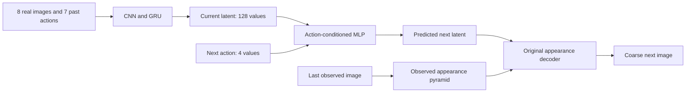
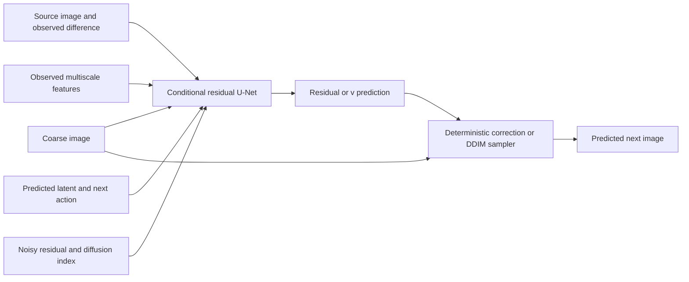

# Architecture and code map

## Model progression across milestones

| Stage | Learned system | Main implementation |
|---|---|---|
| Initial model | CNN features, GRU vector state, action MLP transition, direct transpose-convolution decoder | src/model/world_model.py, encoder.py, memory.py, dynamics.py, decoder.py |
| Reconstruction control | Image encoding/decoding with a current-image fitting target | src/model/reconstruction.py |
| Appearance model | Observed multiscale features added to the future-latent decoder | src/model/appearance.py |
| Transport model | Source copy, learned warp and generated-image mixture | src/model/transport.py |
| Spatial alternative | ConvGRU spatial state and spatial transition with the controlled renderer | src/model/spatial.py |
| Detail variants | Bounded/aligned transport, balanced/boundary objectives and horizon curriculum | src/model/transport.py, src/training/detail.py |
| Final residual heads | Frozen appearance backbone plus deterministic or diffusion U-Net correction | src/model/diffusion.py |

The [development record](development-record.md) explains each architecture's
inputs, training objective and experiments. The [checkpoint lineage](../results/checkpoint-lineage.json)
distinguishes warm starts, resumed optimizers, fresh initialization and the
frozen backbone references actually saved by the training code. The detailed
shapes below describe the final selected backbone and residual heads.

## Shared frozen backbone



The released run-056 backbone contains 1,997,987 parameters. Its CNN uses
four kernel-4/stride-2/padding-1 convolutions with channels 32/64/128/128 and
ELU activations. Feature maps have resolutions 32/16/8/4. The deepest 2,048
values project to 256 features, normalized per frame before the 128-state GRU.

The memory begins with a learned linear+tanh mapping of the first feature.
Subsequent inputs concatenate 256 features with four preceding action values.
The dynamics MLP is 132 -> 256 -> 256 -> 128 with ELU hidden activations and
final tanh. The original decoder projects latent values to 128x4x4 and uses
four transpose convolutions with ELU hidden activations and sigmoid RGB output.
Learned 1x1 appearance adapters add last-observation features at matching scales.

The full backbone is frozen in phase E: encoder, memory, dynamics, original
decoder and appearance adapters. Calling it under no_grad and eval mode
prevents both parameter learning and future-target contamination.

## Shared residual U-Net



Each head has 1,934,819 trainable parameters. Initial head tensors match
exactly across the pair. Hidden layers start random; the final 3-channel
convolution starts at zero.

| Component | Shape/channel structure |
|---|---|
| Image input | 12 channels: noisy residual, source RGB, coarse RGB, observed RGB difference |
| Context embedding | 128 latent + 4 scaled action + 64 sinusoidal timestep -> 128 -> 128 |
| Encoder | 64x64x32 -> 32x32x64 -> 16x16x128 -> 8x8x128 |
| Spatial context | 1x1 projections of observed 32x32x32, 16x16x64, 8x8x128 maps |
| Middle | Conditioned residual block at 8x8x128 |
| Decoder | Nearest upsample + skip concatenation: 16x16x128 -> 32x32x64 -> 64x64x32 |
| Output | GroupNorm(8), SiLU, Conv2d to three channels |

Conditioned blocks use GroupNorm with eight groups, SiLU, 3x3 convolutions,
an additive embedding projection and a residual shortcut. Channel-changing
shortcuts use 1x1 convolutions. The U-Net has no attention layers.

The deterministic control sets noisy input and timestep to zero and predicts
a direct residual. Diffusion predicts v at sampled noise levels. Both have
the same high-resolution conditioning, including the raw observed image.
Consequently, this experiment does not isolate a single adapter, feature path,
or architectural change relative to the older decoder.

## Training and sampling pseudocode

```text
freeze backbone
initialize paired head and fresh Adam; initialize EMA
for each training batch in the private data permutation:
    context = frozen_backbone(observed_history, next_action)
    if deterministic:
        prediction = clip(coarse + head(zeros, 0, context) / 2)
        loss = MSE(prediction, actual_next_image)
    if diffusion:
        clean_residual = 2 * (actual_next_image - coarse)
        choose diffusion index and Gaussian noise
        construct noisy residual and v target
        loss = MSE(head(noisy_residual, index, context), v_target)
    backpropagate through head; clip gradients; update Adam and EMA
    periodically evaluate EMA on fixed validation windows and seeds
```

```text
context = frozen_backbone(observed_history, next_action)
draw initial Gaussian residual noise using a target-independent seed
for the 50 descending DDIM indices:
    predict v using residual, index and context
    recover and clip clean residual; advance to next index
return clip(coarse + clean_residual / 2)
```

## Code map

| Responsibility | File |
|---|---|
| Observation CNN, memory and transition | src/model/encoder.py, memory.py, dynamics.py |
| Original appearance prediction | src/model/appearance.py |
| Residual U-Net, schedule and target-free context | src/model/diffusion.py |
| Adam/EMA training, checkpoint continuation | src/training/diffusion.py |
| Individual-sample scoring and paired noise | src/evaluation/diffusion.py |
| Frozen pilot orchestration | src/diffusion_suite.py |
| Portable release export | src/release.py |
| Download verification and dependency-free demo | src/publication.py |
| Table reconstruction and recording bootstrap | src/evaluation/publication.py |

Training checkpoints preserve raw head weights, EMA, optimizer moments, Python/
NumPy/Torch/CUDA RNG and consumed sampler state. Inference bundles export EMA
heads and a separate backbone. Model tensor values are unchanged; serialized
file hashes change when optimizer state and local paths are removed.
