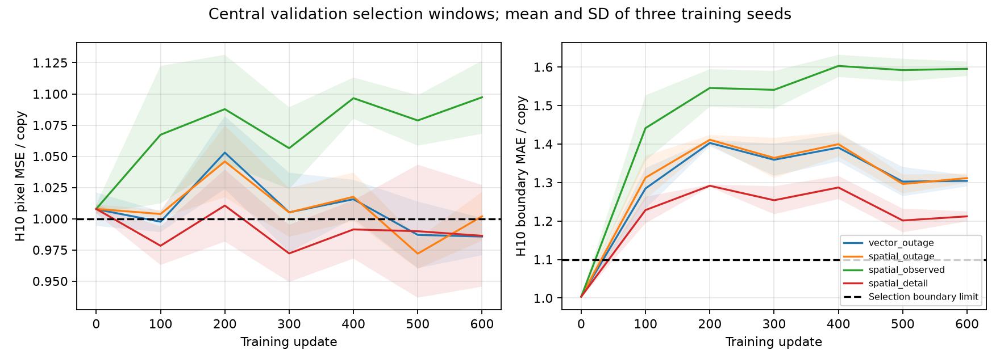
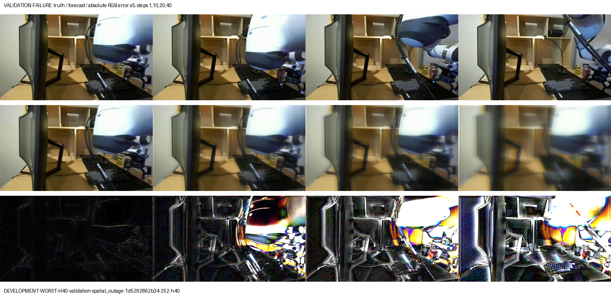

# Action-conditioned visual prediction during camera outages

## Scope and research question

This study extends the frozen DROID one-step pilot with explicit persistent memory,
action-only prediction, and observation-driven correction. It asks how spatial
state and outage-aware training change open-loop prediction and recovery. This is
a bounded offline research pilot, not a new algorithm claim or an operator study.
No RL policy, reward optimization, or planner is introduced.

The implementation follows recurrent-state prediction/filtering ideas from
[PlaNet](https://planetrl.github.io/) and [Dreamer](https://github.com/danijar/dreamerv3).
The prediction/correction distinction is established prior work. Our contribution
is the controlled implementation and measured comparison on a declared DROID
subset; novelty or superiority is not assumed.

## Timeline and mathematical formulation

Actions a_t correspond to the transition from image o_t to o_(t+1). After eight
observed context frames, the next H images are unavailable, the subsequent image
is the first returned observation, and three further pre-observation forecasts
measure recovery. The physical state is unobserved; learned state is not identified
with physical truth. DROID records commands, not proof of their execution.

State contains recurrent memory h_t and an explicit estimated RGB canvas c_t:

$$z_t=(h_t,c_t),\qquad z^-_{t+1}=T_\theta(z_t,a_t),\qquad
\hat o_{t+1}=D(z^-_{t+1})=c^-_{t+1}.$$

For a fresh-observation indicator m_(t+1),

$$z_{t+1}=\begin{cases}
U_\theta(z^-_{t+1},o_{t+1}) & m_{t+1}=1,\\
z^-_{t+1} & m_{t+1}=0.
\end{cases}$$

The forecast is saved and scored **before** correction. The first-return forecast
still has no access to the returned image. Recovery_1 is the next forecast after
that first correction, not reconstruction of the newly received observation.
Availability is explicit benchmark metadata; repeated stale packets are not fresh
observations. Frame indices are the time unit; precise controller units, execution
timing and scene/session independence are not established by this offline reader.

## Data and predeclared protocol

- Keep the original 80 training recordings and ten original validation recordings.
  The ten already inspected old test recordings are excluded from the new test.
- Reserve 20 new eligible recording identities from official DROID v1.0.0 shards,
  excluding all 100 pilot identities before model development. Selection is the
  first eligible unique recordings in shard order, not a random corpus sample.
- Verify source object generation, publisher CRC32C, TFRecord framing and saved
  array SHA256. Preserve native 320x180 RGB and seven explicit Cartesian-velocity/
  gripper-position commands. Train-only command normalization is shared.
- Training chunks use eight observed frames, H in {1,3,5,10}, one return frame and
  three recovery forecasts. Recordings too short for the maximum training chunk
  are excluded and reported. Sampling is uniform over eligible windows with replacement.
- Evaluation horizons are {1,3,5,10,20,40}. Use the same three evenly spaced starts
  per eligible recording for every horizon and method, based on the longest chunk.
  Exclude and report short recordings rather than changing examples across horizons.
- Select on one central validation window per eligible recording at H10. Eligible
  checkpoints keep boundary MAE within +10% and changed-region MSE within +5% of
  copy; choose lowest MSE among them. If none qualify, minimize the sum of MSE,
  changed MSE and boundary error normalized by copy. Initial weights are candidates.
- Freeze all twelve selected checkpoints before scoring any newly reserved test
  recording. Validation diagnostics may be inspected; no tuning follows final test.
- The protocol is recorded and SHA256-identified before training in each run.
  This is an internally frozen protocol, not an external preregistration.

## Architecture

`src/model/outage.py` owns the model interface: initialize, predict, correct, render.
State belongs to the caller. Rendering does not mutate it. There is no hidden
cross-recording memory. Images are padded at the bottom from 180 to 192 and cropped
back after rendering, preserving aspect ratio.

The CNN uses four 4x4 stride-2/padding-1 convolutions with ELU and channels
8/16/24/32; the final map is 32x12x20. Spatial memory is 32x12x20. The vector
comparison pools by 4x4 to 32x3x5, projects to 128 and applies layer normalization.
Both use separate prediction and observation GRUs. An action embedding has 16
coordinates. Prediction GRUs consume the action embedding and previous memory.
Observation GRUs fuse encoded fresh images with predicted memory.

The vector model has 288,019 trainable parameters; spatial variants have 149,491.
The spatial memory has 7,680 coordinates versus 128 for the vector comparison.
Both additionally carry 172,800 RGB canvas values per example: the total state
is not a compact latent bottleneck. Model-state storage does not grow with the
outage length; retained training graphs and saved forecast sequences do.

The shared renderer conditions an evolving canvas feature pyramid on predicted
memory, upsamples through convolution/ELU stages and predicts an RGB residual:

$$c^-_{t+1}=\operatorname{clip}_{[0,1]}
\left(c_t+\tanh R_\theta(C_\theta(c_t),h^-_{t+1})\right).$$

Correction updates memory with the fresh encoded image and replaces the canvas
with its observed pixels. This is intentional data assimilation, not a hidden
future-image shortcut. During outages the canvas is predicted, so rendering has
no permanently frozen real-image cache. Its self-generated appearance features
are internal model computations, not observation corrections. Final residual
weights start with standard deviation 0.001, near copy; all new models start fresh.

## Training and comparisons

Four variants, each trained with independent seeds 3,7,11:

| Variant | Memory | Training observations | Objective |
|---|---|---|---|
| vector_outage | Vector GRU | Contiguous outages | RGB MSE |
| spatial_outage | ConvGRU | Contiguous outages | RGB MSE |
| spatial_observed | ConvGRU | Fresh image after every training forecast | RGB MSE |
| spatial_detail | ConvGRU | Contiguous outages | RGB MSE + 0.05 gradient MAE |

Each receives 600 updates, batch two, fresh Adam at 0.0005 and global gradient
clipping at 10, float32 deterministic PyTorch. Per seed, sampled windows, commands
and horizon schedules match across all four variants. The first third samples
H={1,3}, the second adds 5, and the last adds 10. Every forecast in a chunk,
including recovery forecasts, contributes equally to the loss. Gradients span
the full sampled chunk; there is no temporal detachment inside it.

For batch size B, K=H+1+3 forecasts and N=3x180x320 image values, the pixel term is

$$\mathcal L_{\mathrm{RGB}}=\frac{1}{BKN}
\sum_{b=1}^B\sum_{k=1}^K\|\hat o_{b,t+k}-o_{b,t+k}\|_2^2.$$

The detail branch minimizes
$\mathcal L=\mathcal L_{\mathrm{RGB}}+0.05\mathcal L_{\nabla}$,
where the latter is the mean absolute difference between signed horizontal and
vertical neighboring-pixel differences. It is an image-gradient error, not the
optimizer's parameter-gradient norm. All other branches use the RGB term alone.

The observed-training comparison sees the same target frames but receives fresh
observations between forecasts. This is one-step conditional training, not
outage-trained inference. Parameter counts and wall time need not match the
vector/spatial architectures; report them explicitly. This budget does not
establish convergence or optimal hyperparameters.

Before the main study, fit two high-change central training sequences with H3
for 600 updates at Adam 0.001. Require outage MSE below half initial and copy
MSE, with finite nonzero gradients into every trainable module. Discard tiny-fit
weights and reinitialize each formal branch. Preserve failed attempts.

Controls include freeze-last-image, the existing DROID model with predicted-image
feedback, and H10 validation diagnostics for observed-throughout inference,
reinitialization after reconnection, zero past commands and zero future commands
separately. Substitutions measure conditioning sensitivity, not causal physics.
The existing DROID baseline was trained for 9,264 updates over three epochs and
uses a larger architecture; it is a frozen historical reference, not a compute-
matched training control. The four new variants share the same eligible training
windows; all counts and actual data exposure are retained.

There are 23,670 eligible maximum-length training starts across 79 recordings.
Each branch samples 1,200 windows with replacement, rather than completing an
epoch over these starts. Per-seed sampling is shared across variants, so summed
exposures across variants are model exposures, not unique additional data.
Training wall times include checkpoint validation and reflect a shared workstation
with concurrent verification activity; they are not a controlled speed benchmark.

## Evaluation and evidence

Score outage endpoints, first-return forecasts and three subsequent recovery
forecasts. Report MSE, changed-region MSE, signed gradient MAE, uniform-window
SSIM and AlexNet LPIPS. Outage change masks compare to the last real context
frame; recovery masks compare to the preceding available real observation.
Count and exclude empty change masks from changed-region means.

Retain per-window results, per-checkpoint recording bootstrap intervals (2,000
resamples, seed17) and training-seed means/standard deviations separately.
Recording bootstrap assumes recording independence, which is limited without
scene/session grouping; do not treat overlapping windows as independent samples.
Warm GPU prediction/render latency excludes data loading, metric computation and
video encoding. Example playback speed is illustrative, not verified camera fps.

Record exact source ZIP, environment, data/protocol identity, sampling schedule,
normalization, optimizer/RNG state, initial/scheduled/best/latest checkpoints and
checkpoint hashes. Save exact numerical rollout videos and GIFs for protocol-fixed
examples. Tests cover hidden-target exclusion, state continuity, action timing,
forecast-before-correction ordering, recovery gradients, render immutability,
state replay and real deterministic CUDA multistep backward.

The recorded pilot ran from a working tree based on commit `1d4f731`, not from
the final publication commit. Documentation, replay, curation and viewer tools
were completed during training. The six core model/data/config/training/evaluation
source files are byte-identical across the twelve training snapshots; the
curation command verifies this. Each run retains its own exact source ZIP and
source fingerprints. These snapshots identify executed research code more
precisely than attributing historical training to a later clean commit.

## Commands and local outputs

| Module | Responsibility |
|---|---|
| `src/prepare_outage.py` | Reserve and verify new recording identities and source objects |
| `src/data/outage.py` | Recording-bounded chunks, fixed windows and protocol identity |
| `src/model/outage.py` | Explicit state, prediction, correction and read-only rendering |
| `src/training/outage.py` | Tiny fitting, matched sampling, joint gradients and checkpoint selection |
| `src/evaluation/outage.py` | Shared timeline, baselines, forecast metrics, bootstrap and numerical videos |
| `src/outage_study.py` | Ordered training, freezing, controls and final test orchestration |
| `src/outage_diagnostics.py` | Descriptive validation controls and explicitly chosen failure examples |
| `src/outage_conditioning.py` | Direct output differences under command substitution and memory reset |
| `src/outage_viewer.py` | Saved-artifact playback; no alternative inference implementation |
| `src/outage_replay.py` | Dataset-free inference fixtures and checkpoint/output verification |
| `src/outage_export.py` | Complete portable bundle, hash verification and isolated restoration |
| `src/outage_report.py` | Curated metrics, source consistency, recording means and selection curves |

```powershell
uv run --locked python -m src.prepare_outage
uv run --locked python -m src.outage_study
```

Configuration: `configs/camera-outage.json`. Source downloads and the reservation
manifest live in ignored `data/camera-outage/`; per-execution records live in ignored
`evaluation/runs/camera-outage/run-NNN/`. Existing BAIR/DROID records are unchanged.

The pipeline prints its parent study run. `children.json` identifies training and
final-test runs; `evaluations.json` identifies validation/control runs. The parent
retains `frozen-checkpoints.json`, `results.json`, `seed-summary.json`, `report.md`
and `outage-curves.png`. Child records hold exact checkpoints, predictions,
action/recovery controls, uncertainty estimates, timings and fixed example videos.
The `test_has_been_scored: false` field in `frozen-checkpoints.json` is the receipt's
state when it was written before testing, not a live completion flag. Parent and
child `status.json` files record execution completion separately.

## Measured pilot outcome

Parent `evaluation/runs/camera-outage/run-002` completed twelve 600-update branches
(7,200 formal updates, excluding tiny fitting). **All twelve selected update 0.**
The trained states did not meet the fixed boundary-quality rule. Test scoring
therefore measures the selected near-copy initial models, not successful trained
outage predictors. Three spatial training variants have identical selected
tensors per seed, so their selected test results are identical. Their reported
seed variability is initialization variability in this pilot.

| New test method | H1 RGB MSE | H10 RGB MSE | H40 RGB MSE |
|---|---:|---:|---:|
| Copy last available image | 0.001238 | 0.006844 | 0.016974 |
| Historical DROID model with image feedback | 0.001503 | 0.010106 | 0.023071 |
| Selected vector state, three-seed mean | 0.001238 | 0.006911 | 0.018043 |
| Selected spatial state, three-seed mean | 0.001238 | 0.006901 | 0.017733 |

Lower is better. These are 60 fixed windows from twenty reserved recordings,
with the limitations on recording independence stated above. The spatial mean
is 0.82% worse than copy at H10 and 4.47% worse at H40. The historical baseline's
one-step result on the old pilot holdout did not translate into winning this
new test protocol; the dataset/windows differ, so this is not a direct repeated
estimate of the old test score.

Tiny fitting passed: training-sequence outage MSE fell from 0.021777 to 0.004418,
against copy 0.021749. This verifies fitting and gradient flow on two sequences;
it does not establish generalization. Central validation selection curves show
that trained pixel/changed-region improvements coexist with worse boundary error.
The detail loss reduces that deterioration relative to the pixel-only control,
but does not produce a qualifying checkpoint under this budget. No selection
rule was relaxed after observing results.

Descriptive **unselected update-600 validation** results use all thirty fixed
validation windows, rather than the ten central checkpoint-selection windows:

| Method | H10 RGB MSE | H10 boundary MAE |
|---|---:|---:|
| Copy | 0.010309 | 0.015769 |
| Vector outage, three-seed mean | 0.010138 | 0.020672 |
| Spatial outage, three-seed mean | 0.010278 | 0.020794 |
| Spatial observed training, three-seed mean | 0.011126 | 0.025321 |
| Spatial detail, three-seed mean | 0.010132 | 0.019210 |

Outage training and the detail loss improve some validation quantities relative
to the observed-training control, but boundary error remains worse than copying.
These are post-study descriptions, not new checkpoint selections or test wins.

Direct output sensitivity also remains small on this probe. For the unselected
spatial-outage model at H10, replacing future commands by raw zeros changes
forecast pixels by mean absolute 0.000628 on the [0,1] scale; replacing past
commands changes them by 0.0000245. Resetting rather than fusing memory changes
the first recovery forecast by 0.0000269. Values are whole-image averages over
thirty validation windows and three seeds; local changes can differ. This is
conditioning sensitivity, not causal identification or proof that latent memory
contains no information. Recovery target MSE likewise shows no meaningful
demonstrated benefit of learned fusion over reinitialization in this pilot.

The combination of progressively smoothed appearance and small conditioning
effects is consistent with the renderer relying mainly on its canvas pathway.
That is a hypothesis supported by these probes, not an isolated causal mechanism.
A follow-up should test motion preservation and the use of commands/memory under
a newly frozen protocol before treating diffusion or longer training as a remedy.

The complete curated [report](../results/camera-outage/report.md),
[checkpoint selection history](../results/camera-outage/checkpoint-selection.json)
and [per-recording evidence](../results/camera-outage/per-recording.json) retain
the comparisons and negative results. Unselected latest-state validation scores
are descriptive evidence, not replacement test estimates. The implementation
supports persistent prediction and correction; their useful learned performance
has not been demonstrated by this pilot.



In the two ranked spatial validation failures, the arm moves substantially while
predictions retain stale arm structure and increasingly blur the scene. Previously
occluded regions are not recovered correctly. These observations describe the
displayed failures, not measured contact or occlusion categories across the dataset.



Rows are withheld truth, model forecast and absolute RGB error amplified fivefold.
Columns are outage steps 1, 10, 20 and 40. This example is deliberately selected by
validation error; it is not a representative test sample. Imagery: DROID,
Khazatsky et al. (2024), CC BY 4.0; selected, annotated and scored here.

## Reproduction and limits

### Inspecting and reproducing saved forecasts

After the study completes, run descriptive diagnostics and capture self-contained
inference fixtures. Substitute the parent run printed by the study command:

```powershell
uv run --locked python -m src.outage_diagnostics --run evaluation/runs/camera-outage/run-002
uv run --locked python -m src.outage_conditioning --run evaluation/runs/camera-outage/run-002
uv run --locked python -m src.outage_replay create --run evaluation/runs/camera-outage/run-002
uv run --locked python -m src.outage_viewer --run evaluation/runs/camera-outage/run-002 --port 8770
```

The viewer plays saved numerical predictions. It includes protocol-selected
test/validation outputs, explicitly unselected latest training outputs on
validation, tiny-fit training memorization and fixed validation baselines.
The camera panel freezes during outages; withheld truth is a research comparison,
never an input to the unavailable-observation steps. Playback has no physical
timing claim. The fixed demonstration seed is 3 and the example windows are
the first three in the protocol, which can belong to the same recording.
Additional worst-H40 development examples are ranked by validation MSE, with
two distinct recordings per variant and the selection rule saved explicitly.
They illustrate failures and are not representative final-test examples.

The complete archive includes all child runs, initial/scheduled/best/latest
checkpoints, optimizer/RNG/sampler states, source/environment snapshots,
per-window metrics, saved predictions and the historical DROID baseline run.
No raw dataset or external pretrained evaluation weights are bundled:

The published pilot bundle is available with the
[camera-outage prerelease](https://github.com/Elaybarnoam/action-conditioned-visual-world-model/releases/tag/v1.2.0-camera-outage-pilot).
Download every `camera-outage-*.zip` part and `manifest.json` to the same directory.

```powershell
uv run --locked python -m src.outage_export export --run evaluation/runs/camera-outage/run-002 --destination data/outage-release
uv run --locked python -m src.outage_export verify --manifest data/outage-release/manifest.json
uv run --locked python -m src.outage_export restore --manifest data/outage-release/manifest.json --destination data/outage-restored
```

The manifest retains original and portable hashes. Restoration verifies archive
membership, sizes and every file hash; it refuses escaping paths or overwriting
different existing files. Point the viewer at the restored parent directory.
Each replay fixture contains all eight context frames, seven past commands,
future commands, target frames and saved forecasts, plus its checkpoint hash.
Replay requires no dataset download:

```powershell
uv run --locked python -m src.outage_replay verify --fixture <fixture.pt> --checkpoint <checkpoint.pt> --device cpu
```

Verification checks maximum absolute output error against 0.0001, allowing
floating-point differences between devices and batch sizes. Train/test targets
are retained for scoring but remain unavailable to the model during the outage.
The published bundle contains 956 files in nine parts, including 135 checkpoints
and 82 numerical rollout files; compressed size is approximately 2.82 GB.
Its restoration verified every archive member. All five restored fixtures passed
CPU replay; maximum absolute difference was 0.00000206.

Curated evidence has its own file membership and SHA256 checks, included in CI:

```powershell
uv run --locked python -m src.outage_report --verify
```

For a new completed study, curate into a new directory using `--run <parent>` and
`--destination data/new-outage-curation`. Existing destinations are not replaced.
Run source snapshots contain captured Python/config files, dependency metadata
and the study document; the Git release contains the complete final source,
tests and HTML viewer.

For training from a new checkout, first follow the original DROID preparation
instructions in [the pilot](droid-experiment.md). Restore the historical baseline
checkpoint/run evidence, or run that pilot and set `baseline_run` to the resulting
run; a newly trained baseline is a new comparison, not the original checkpoint.
Install the locked environment with `uv sync --locked`. The study configuration
defaults to CUDA; CPU inference replay is supported. Automatic interrupted-study
resume is not implemented, although continuation state is retained.

### Scientific limitations

The recorded-actions experiment uses frame steps, not measured wall-clock delays.
Irregular live action streams would need synchronization and an explicit treatment
of elapsed time before any deployment claim.

No calibrated uncertainty, counterfactual identification, operator utility,
scene-disjoint generalization or benchmark superiority is established by this
pilot. Forty-frame rollouts extrapolate beyond the maximum ten-frame training
outage. Scene changes, occlusions and command/execution mismatch can invalidate
predictions. Stochastic state, diffusion, transport rendering and larger-scale
training are separate follow-up comparisons, not automatic extensions of a win.

DROID data and derived imagery require CC BY 4.0 attribution to the DROID dataset
authors (Khazatsky et al., 2024); repository code licensing does not replace data
terms. Raw DROID recordings are not committed to Git.
