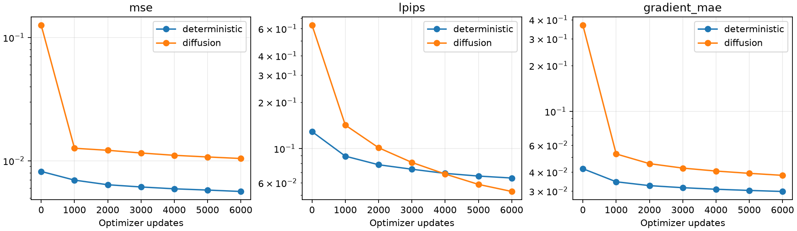

# Experiments, findings and evidence audit

This document details the final phase-E comparison. The complete project,
including initial training, scaling and phases B–D, is reported in the
[milestone history](project-history.md) and
[full development record](development-record.md). All saved checkpoints and
evaluations are available through the [complete archive](history-artifacts.md).

## Scope and experimental units

The main study is phase E: a paired one-step pilot on a fixed BAIR subset.
Training contains 10,000 complete recordings; validation contains 51; the
official test split contains 256. The original 51-recording holdout is kept
when training data is expanded in archive order. This is not the full BAIR
training corpus, a random full-corpus subsample, or a leaderboard replication.

Each model sees eight observations and seven past actions, then predicts the
next observation given the next action. No position measurements enter the
predictor. Final validation has 22 overlapping windows per recording. The
stochastic head generates three individual samples per window; the
deterministic heads generate one.

## Main controlled comparison

| Setting | Value |
|---|---|
| Frozen backbone | run-056, selected appearance model |
| Head branches | run-118 deterministic; run-121 diffusion |
| Head architecture/parameters | Identical conditional U-Net; 1,934,819 each |
| Training seed | 3; one paired training run |
| Initial conditions | Identical head tensors, complete private permutation, fresh Adam |
| Update budget | 6,000 each; batch 16; 96,000 windows spanning all 10,000 recordings |
| Adam learning rate / clipping | 0.0002 / global norm 10 |
| EMA | min(0.999,(1+update)/(10+update)) |
| Selection | 51 starts at frame 0, every 1,000 updates |
| Selected head weights | EMA at update 6,000 for both |
| Diffusion | 100 cosine timesteps, v target, 50 eta=0 DDIM steps |
| Sample seeds | 1301, 2603, 3907; SHA-256 recording/start keyed CPU Gaussian noise |
| Final evaluation | 1,122 validation windows; all 3,366 diffusion samples |
| Training device | RTX 5060 Laptop GPU, 8 GiB; float32; deterministic algorithms |

Selection requires >=5% LPIPS improvement and >=1% boundary improvement while
both MSE and changed-region error stay within +5% of the original. Qualifying
states rank first, then by normalized LPIPS plus boundary error. This rule
was frozen before training. The final validation comparison includes the
selection subset; it is not a new independent test.

## Main results

| Model | MSE ↓ | Changed MSE ↓ | Boundary MAE ↓ | LPIPS ↓ | SSIM ↑ |
|---|---:|---:|---:|---:|---:|
| Original run-056 | 0.0081583 | 0.0260891 | 0.041479 | 0.122070 | 0.829122 |
| Deterministic residual U-Net | **0.0053881** | **0.0189077** | **0.028624** | 0.056710 | **0.904001** |
| Diffusion residual U-Net | 0.0101739 | 0.0367802 | 0.036284 | **0.046433** | 0.848224 |

Relative to the original, the deterministic head reduces MSE 33.96%, changed
error 27.53%, boundary error 30.99% and LPIPS 53.54%. It passes pilot gates.
Diffusion reduces LPIPS 61.96% and boundary error 12.52%, but increases MSE
24.71% and changed-region error 40.98%. It fails the accuracy gates.

**Conclusion:** this deterministic residual head gives the stronger
accuracy/appearance compromise at the tested budget. Diffusion gives the
lowest perceptual distance and visibly sharper details in inspected examples,
with less accurate correspondence to the recorded future. The study does not
establish superiority of either model family across tasks or compute budgets.

The fixed panels show all diffusion samples and the deterministic control.
They were selected from earlier benchmark windows before phase-E model
training, not selected by predicted quality. Lower/higher change refers to
the earlier 20-frame image-change proxy, not labeled object movement.

Source frames: BAIR, Ebert et al. (2017), CC BY 4.0. Layout, enlargements and
predictions are derived outputs of this project. The diffusion samples restore
clearer robot markings, while sampled positions and generated details vary.

Curves show the fixed 51-window selection set, not the full final validation
set. Improvement through the budget endpoint is not proof of convergence.

## Recording-level uncertainty estimates

After freezing model outputs, we computed 5,000 paired percentile-bootstrap
replicates, seed 17. A replicate samples 51 whole recordings with replacement
and retains their windows and sample seeds. Valid-row counts are retained for
changed-region scoring. Numbers below are 95% intervals for percent error
change relative to the original; negative means lower error.

| Head | MSE change | Changed MSE change | Boundary change | LPIPS change |
|---|---|---|---|---|
| Deterministic | [-39.95, -27.41]% | [-31.92, -22.46]% | [-33.05, -28.80]% | [-55.46, -51.55]% |
| Diffusion | [22.76, 26.67]% | [38.08, 44.02]% | [-15.35, -9.86]% | [-63.69, -60.01]% |

This is a post-freeze descriptive analysis conditional on the current split,
checkpoint-selection procedure, trained models and three noise seeds. It
does not measure training-seed variation or remove validation-selection bias.
The machine-readable method and intervals are in results/recording-bootstrap.json.

## Action controls and sample variation

Zero-next-action controls preserve the observed history and initial noise.
Both heads score better with the recorded next actions on the 51 selection
windows. This demonstrates sensitivity to conditioning; zeroed commands may
be implausible and the test does not identify causal physical dynamics.

The within-sample variance contribution is approximately 0.0024158 of the
diffusion sample MSE 0.0101739. The algebraically implied empirical sample-mean
error is 0.0077581. No averaged image is displayed or selected; this diagnostic
does not demonstrate calibrated uncertainty or provide an oracle sampler.

## Historical ablations and negative findings

The experiment index includes failed runs and completed predecessors. The
evidence release bundle contains their configurations, environment/source
fingerprints, summaries and result files with local paths normalized in copies.

| Phase | Question | Observation | Limit |
|---|---|---|---|
| B | Can optimization/loss/latent width resolve blur? | More training improves pixels; L1+gradient improves boundaries with a pixel tradeoff; doubling a vector yields a small gain | Single budgets/seeds; blur remains |
| C1 | Can observed appearance improve prediction? | Appearance access improves the selected original model; a data-order repeat supports its direction | Warm-start repeat shares base weights |
| C2/C3 | Does a copy/warp/generate renderer transport detail? | Earlier warp is suppressed; out-of-bounds sampling is high | No labeled real optical-flow truth |
| C4 | Does 8x8 spatial memory fix motion? | Tested ConvGRU variant fails long-rollout promotion guards | Does not rule out other spatial models |
| D1 | Can the decoder fit sharp outputs? | One moving-window fit passes; 32-window fit misses combined accuracy gate despite sharp examples | Memorization is not generalization |
| D2/D3 | Can flow be repaired? | Toy translation EPE 0.1541 px; six-example out-of-bounds fraction falls 92.29% to 20.62% | Toy conventions do not calibrate robot motion; replay is six examples |
| D4 | Do balanced/boundary losses qualify? | Tested loss branches retain initial quality-selected states | Budgets do not prove optimality |
| D5 | Does longer supervision help? | Curriculum improves h20 MSE 13.16%, but h3 changed error worsens 4.69% | Fails frozen 2% tolerance |

Historical phases C/D used different multi-horizon selection rules and
training conditions. Their numbers are not interchangeable with the phase-E
one-step table. The official test was used in earlier phases; phase E uses
validation only. No new untouched-test claim is made.

## Claim-to-evidence audit

| Claim | Evidence | Status |
|---|---|---|
| Matching the new head architecture improves this backbone's one-step accuracy | run-118/119, frozen paired control, per-window scores | Supported within pilot |
| Diffusion improves perceptual fidelity at this budget | run-121/122 LPIPS and all fixed samples | Supported within pilot |
| Diffusion improves target correspondence | MSE and changed-region errors worsen | Not supported |
| Blur is entirely caused by unavoidable uncertainty | No isolating/calibration experiment | Not established |
| New heads improve recursive world simulation | No phase-E multistep evaluation | Untested |
| Results replicate across training seeds | One phase-E training seed | Untested |
| This is a new diffusion algorithm or benchmark record | No novelty/leaderboard experiment | Not claimed |

## Compute reporting

The hardware/software environment and complete stage timestamps are in the
evidence bundle. Full final scoring took 1.96 s for the deterministic head and
175.24 s for diffusion, including metrics/artifacts and three samples per
window. These are evaluation totals, not isolated per-image latency. Head
architecture and update budgets match; denoising incurs substantially more
inference computation. Exact wall times depend on device, batching and I/O.
